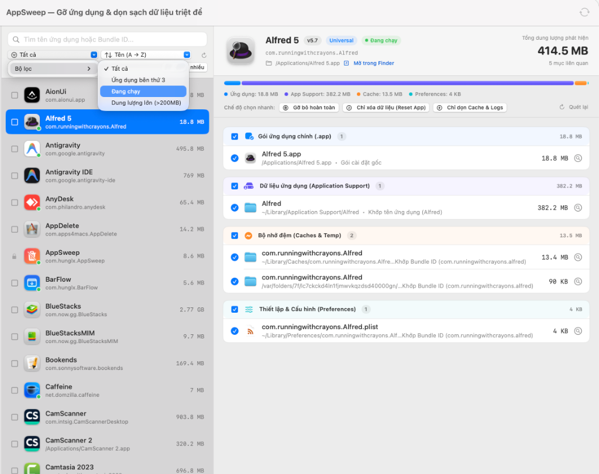

# AppSweep for macOS

**AppSweep** là ứng dụng tiện ích gốc (Native Swift / SwiftUI) siêu nhẹ cho macOS, lấy cảm hứng từ **AppDelete**, giúp **gỡ cài đặt ứng dụng trên Mac (đơn lẻ hoặc hàng loạt), lọc ứng dụng bỏ quên theo mức độ sử dụng và dọn dẹp triệt để 100% dữ liệu rác liên quan** ẩn sâu trong hệ thống một cách an toàn.

<p align="center">
  
</p>

## ✨ Tính năng nổi bật

- **Quét sâu 11 tầng hệ thống (`DeepFileScanner`)**:
  - Tự động trích xuất `CFBundleIdentifier`, `TeamIdentifier` (từ chữ ký số Apple Code Signing), các Helper / LoginItems nhúng bên trong `.app`, và `SMPrivilegedExecutables`.
  - Quét toàn diện:
    1. `~/Library/Application Support` & `/Library/Application Support` (kể cả thư mục con theo hãng như `Google/Chrome`, `Microsoft/...`, `AdGuard Software`)
    2. `~/Library/Containers` (hỗ trợ đọc metadata UUID Container trên macOS Sonoma / Sequoia / Tahoe / macOS 27)
    3. `~/Library/Group Containers` (tích hợp **Sibling-App TeamID Guard**: tự phát hiện dữ liệu dùng chung `Team ID` khi máy còn cài ứng dụng khác cùng hãng để tránh xóa nhầm!)
    4. `~/Library/Caches`, `/Library/Caches`, và bộ đệm ẩn Darwin `/var/folders/.../C` & `/T`
    5. `~/Library/Preferences`, `ByHost`, `/Library/Preferences` (tự động làm mới `cfprefsd` để `.plist` không bị ghi đè ngược từ RAM sau khi xóa)
    6. `~/Library/LaunchAgents`, `/Library/LaunchAgents`, `/Library/LaunchDaemons`, `/Library/PrivilegedHelperTools` (đọc cả nội dung plist `Program`, `ProgramArguments`, `AssociatedBundleIdentifiers` và tự `launchctl bootout` trước khi xóa)
    7. `~/Library/Saved Application State` & `Autosave Information`
    8. `~/Library/HTTPStorages`, `WebKit`, `Cookies`
    9. `~/Library/Logs` & `DiagnosticReports` (Crash / `.ips`)
    10. Biên lai cài đặt `.pkg` tại `/private/var/db/receipts`
    11. Thư mục cấu hình ẩn `~/.config`, `~/.cache`, `~/.local/share` và `~/.<app>`
- **Chọn nhiều & Gỡ cài đặt hàng loạt (`Batch Uninstall`)**:
  - Tích chọn cùng lúc nhiều ứng dụng để quét sâu song song, xem tổng dung lượng thu hồi của cả lô, mở rộng kiểm tra chi tiết từng file của từng ứng dụng.
  - Gộp quyền quản trị: chỉ hỏi xác thực **Touch ID / Mật khẩu Admin đúng 1 lần duy nhất** cho toàn bộ lô ứng dụng được chọn.
- **Bộ lọc & Thống kê Mức độ sử dụng (`Usage Level Filter`)**:
  - Phân tích dữ liệu sử dụng thực tế từ Spotlight (`kMDItemLastUsedDate`, `kMDItemUseCount`, `kMDItemDateAdded`) kết hợp `Saved Application State`.
  - Lọc nhanh bằng thanh chip trực quan: **Tất cả**, **Không dùng** *(Chưa từng mở + Bỏ quên > 90 ngày)*, **Chưa mở**, **> 90 ngày**, **30–90 ngày**, **Thường xuyên** — kèm bộ sắp xếp **Lâu chưa mở nhất** và **Dùng nhiều nhất** để dễ dàng phát hiện các ứng dụng chiếm bộ nhớ vô ích.
- **Kéo & Thả linh hoạt kiểu AppDelete**:
  - Kéo thả một hoặc nhiều `.app` / Plugin vào cửa sổ `AppSweep` **hoặc thả thẳng lên biểu tượng `AppSweep` trên thanh Dock**.
- **Gỡ tiện ích mở rộng (`Addons`) & Quét file rác mồ côi (`Orphans`)**:
  - Quản lý và gỡ sạch `PreferencePanes` (`.prefPane`), `QuickLook` (`.qlgenerator`), `Screen Savers` (`.saver`), `Internet Plug-Ins` (`.plugin`), `Audio Plug-Ins` (`AU / VST / VST3`), và `Services`.
  - Tìm các thư mục dữ liệu, cache, container và các `LaunchAgents` bị gãy đường dẫn còn sót lại từ những ứng dụng bạn từng xóa thủ công bằng cách kéo thẳng vào Trash trước đây.
- **3 chế độ dọn thông minh & An toàn tuyệt đối**:
  - **Gỡ bỏ hoàn toàn** · **Chỉ xóa dữ liệu (Reset App)** · **Chỉ dọn Cache & Logs**.
  - **Đóng gói ngăn nắp vào Thùng rác**: Gom toàn bộ file xóa vào thư mục riêng trong `~/.Trash` kèm `restore_manifest.json`.
  - **Hoàn tác 1 chạm (`Undo`)**: Khôi phục cả `.app` lẫn từng file `Preferences`, `Application Support`, `Containers` về đúng vị trí gốc chỉ với 1 cú nhấp chuột.
  - **Sao lưu `.zip` trước khi xóa** vào `~/Downloads/AppSweep Backups` và **tự động gỡ biểu tượng dấu `?` khỏi thanh Dock**.
- **Cập nhật tự động 1 chạm qua GitHub (`UpdateCheckerService`)**:
  - Đối chiếu trực tiếp tag & bản phát hành mới nhất từ [`hungmtuci/AppSweep`](https://github.com/hungmtuci/AppSweep/releases) ngay trên thanh công cụ, thanh bên trái và menu `AppSweep → Kiểm tra cập nhật... (⌘U)` (tích hợp cơ chế dự phòng HTML Redirect khi GitHub API bị giới hạn lượt truy cập).
  - Tải gói cập nhật mới với thanh tiến trình trực tiếp, kiểm tra tính toàn vẹn `CFBundleIdentifier`, tự động thay thế `AppSweep.app`, gỡ cờ cách ly Gatekeeper (`xattr -cr`) và khởi động lại mượt mà.

## ⌨️ Phím tắt nhanh

| Phím tắt | Chức năng |
| :--- | :--- |
| `⌘ + O` | Chọn một hoặc nhiều ứng dụng `.app` / Plugin từ Finder để quét sâu |
| `⌘ + R` | Làm mới danh sách ứng dụng & dữ liệu mức độ sử dụng |
| `⇧ + ⌘ + F` | Chuyển nhanh sang tab **Quét file rác mồ côi (Orphans)** |
| `⌘ + U` | Kiểm tra và tải bản cập nhật mới nhất từ GitHub |
| `⌘ + 1` | Mở lại cửa sổ chính `AppSweep` |
| `⌘ + Q` | Thoát hoàn toàn `AppSweep` |

---

## 📥 Tải về & Cài đặt nhanh (macOS 14.0+ Universal: Apple Silicon & Intel)

1. Tải bộ cài mới nhất tại trang **[Releases](https://github.com/hungmtuci/AppSweep/releases/latest)**:
   - **`AppSweep-Installer-v1.3.0.dmg`** *(Khuyên dùng)*
   - Hoặc **`AppSweep-v1.3.0-macOS.zip`**
2. Mở file `.dmg`:
   - Kéo `AppSweep.app` thả vào thư mục **`Applications`**, **HOẶC** nhấp chuột phải vào `Cai_Dat_AppSweep.command` → chọn **Open** để tự động cài đặt vào `/Applications` và gỡ cờ cách ly Gatekeeper.
3. Nếu macOS báo ứng dụng chưa công chứng Apple Developer ID khi mở lần đầu trên máy mới, chạy lệnh sau trong Terminal:
   ```bash
   xattr -cr /Applications/AppSweep.app && open /Applications/AppSweep.app
   ```
4. *(Khuyên dùng)* Cấp quyền **Full Disk Access (Truy cập Toàn bộ Đĩa)** trong **System Settings → Privacy & Security → Full Disk Access** (có nút mở nhanh ngay ở góc dưới bên trái `AppSweep`) để ứng dụng quét sạch 100% các thư mục `~/Library/Containers` được macOS bảo vệ.

---

## 🛠️ Tự biên dịch & Phát hành phiên bản mới

Yêu cầu: macOS 14.0+ và Xcode hoặc Command Line Tools (`xcode-select --install`).

```bash
git clone https://github.com/hungmtuci/AppSweep.git
cd AppSweep
chmod +x build_appsweep.sh
./build_appsweep.sh
```

Sau khi chạy xong `./build_appsweep.sh`:
- Ứng dụng Universal Binary (`arm64` + `x86_64`) được tạo tại `./AppSweep.app`
- Bộ cài `.dmg` và gói `.zip` phục vụ cập nhật tự động được xuất tại `./dist/`

### Phát hành bản cập nhật mới lên GitHub (Auto-Update)
Kho mã nguồn đã tích hợp sẵn cả **GitHub Actions** ([`.github/workflows/release.yml`](.github/workflows/release.yml)) và script phát hành nhanh:
- **Cách 1 (Tự động qua GitHub Actions)**: Chỉ cần đẩy tag mới định dạng `vX.Y.Z` (ví dụ `git tag v1.3.0 && git push origin v1.3.0`), GitHub Actions sẽ tự động biên dịch Universal Binary và tạo Release kèm `.dmg` & `.zip`.
- **Cách 2 (Đóng gói cục bộ & đẩy Release tức thì qua `gh` CLI)**:
  ```bash
  ./scripts/release_github.sh 1.3.0 "Mô tả tính năng mới"
  ```

## 📄 Giấy phép

Phát hành theo giấy phép [MIT License](LICENSE).
